<div align="center">

<!-- Dino loncat -->


<br/>

<!-- Profile Views Counter -->


</div>

---

## About Me

```yaml
name: Muhamad Nur Isnan
university: UPN Veteran Yogyakarta
location: Yogyakarta, Indonesia
contact: muham.naniz@gmail.com
```

---

## 🌐 Socials

<div>

[](https://instagram.com/iznss_) [](mailto:muham.naniz@gmail.com) [](https://github.com/IsnaZ23)

</div>

---

## 💻 Tech Stack

<div>


</div>
